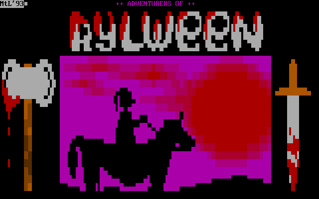

# Adventurers of Rylween
Kotlin port and runtime workspace for Adventurers of Rylween, a MUD
style game for BBSes that I wrote in 1992-1993.

<p align="center">
  
</p>

## Running The Game

### On Your Network: `./deploy.sh`

```sh
./deploy.sh
```

This is the one command for hosting the game. It builds the bitmap web game's
image and starts it with Docker Compose (Podman Compose when Docker is missing),
published on this machine's private LAN address, port 8081, and prints the
address when the server is up. Open it in a browser on any machine on the
network and register an account. The build runs inside the image, so the host
needs only Docker or Podman, not a JDK.

Run `./deploy.sh` again after pulling changes to rebuild and restart. Saves,
accounts, and logs live on the `rylween_data` volume and survive rebuilds;
`docker compose -f deploy/compose.yaml down` stops the server and keeps them.

On first start the server creates the sysop account, `admin`, which gets the
game's secret wilderness keys. Unless `RYLWEEN_ADMIN_PASSWORD` is set, its
password is generated:

```sh
docker compose -f deploy/compose.yaml exec rylween cat /data/auth/admin-password.txt
```

To change the port, the data location, or the accounts, copy
`deploy/.env.example` to `deploy/.env` and edit it.
[`deploy/docker/README.md`](deploy/docker/README.md) covers the settings,
backups, and the production images, and
[`runtimes/runtime-web/README.md`](runtimes/runtime-web/README.md#exposing-a-production-docker-deployment)
covers putting the game on the internet behind an HTTPS reverse proxy.

### In A Terminal: `./bin/run.sh`

```sh
./bin/run.sh --build
```

This builds the game and plays the ANSI version in the current terminal. It
needs JDK 23 or newer; Gradle downloads the JDK 25 toolchain the modules build
with if none is installed. Size the terminal to at least 80 columns by 25 rows.
At the splash screen press RETURN, then `N` to create a party. Move with the
arrow keys or the keypad digits 8, 2, 4, and 6; press `?` in the wilderness for
the full list of commands, and `X` to quit. The save and logs go to
`~/.rylween/data`.

[`bin/README.md`](bin/README.md) lists the other launchers and their options,
such as starting with a seeded Strong party, and the local web servers.

The game streams ANSI escape codes (color, cursor positioning) and uses
ambiguous-width Unicode characters in some art. How those characters are
sized depends on the terminal:

- **macOS `Terminal.app`** renders East-Asian-Width-ambiguous characters
  as 2 cells wide. Some art and layouts drift as a result. This isn't a
  bug in the game — `Terminal.app` makes the wrong call for the
  character set the game uses.
- Recommended terminals that get this right out of the box:
  **iTerm2**, **Ghostty**, **Alacritty**, **Kitty**, and **WezTerm**.
  Any of these renders the art as intended on macOS, Linux, and BSD.

If you must run in `Terminal.app`, expect occasional one-cell drift in
borders and decorative art. Gameplay text is unaffected.

## The Code

The current version is 0.9.1, set by `rylween.version` in `gradle.properties`.
It shows on the title menu, in the bitmap page's title bar, in `/api/status`,
and in the `log.open` line of every runtime log.

The current runnable Kotlin game is the `:runtime` project. Shared
DSL/compiler and compiled-bundle contracts live under `:core`, authored game
DSL and resources live under `:game`, the compiled-bundle emitter and its checks
live under `:tools`, and ANSI terminal primitives live under `:terminal`.

The complete game DSL, the whole authored game from the world map and monsters
to every mission script, is
[`RylweenGame.kt`](game/src/main/kotlin/rylween/game/RylweenGame.kt); it pulls
in the sound and music from
[`RylweenAudio.kt`](game/src/main/kotlin/rylween/game/RylweenAudio.kt).
The original game text and manual live in
[`adventurers-of-rylween.md`](game/src/main/resources/adventurers-of-rylween.md).

Module guides:

- [DSL authoring guide](docs/dsl-authoring.md) - how to modify or extend the
  authored game.
- [`:core`](core/README.md) - DSL, validation, compiled bundle contracts.
- [`:game`](game/README.md) - authored Rylween game script, fixtures, assets.
- [`:runtime`](runtimes/runtime/README.md) - shared game runtime and direct ANSI terminal.
- [`:runtime-web`](runtimes/runtime-web/README.md) - browser-served ANSI runtime.
- [`:runtime-bitmap-web`](runtimes/runtime-bitmap-web/README.md) - canvas bitmap runtime.
- [`:web-common`](support/web-common/README.md) - shared web HTTP, WebSocket, auth, status.
- [`:terminal`](support/terminal/README.md) - ANSI terminal primitives.
- [`:tools`](support/tools/README.md) - emits, checks, and inspects the compiled bundle.
- [`support/audio`](support/audio) - Python scripts that synthesize the sound effects, music, and ambient loops.
- [`build-logic`](build-logic/README.md) - Gradle conventions and custom tasks.
- [`bin`](bin/README.md) - local developer/operator launcher scripts.
- [`deploy/docker`](deploy/docker/README.md) - Docker images, compose, the LAN deploy scripts, and reverse-proxy notes.

The old interpreted Kotlin ANSI project and the historical C/JSON5 port are no
longer part of this repository. The original Amiga release is kept as described
in the appendix.

## Verification

Run the normal verification graph:

```sh
./gradlew check --console=plain
```

`check` also runs `checkDependencyUpdates`, which only reports newer dependency
and plugin versions from `gradle/libs.versions.toml`. To apply those catalog
updates intentionally, run:

```sh
./gradlew updateDependencyCatalog --console=plain
```

CI (`.github/workflows/ci.yml`) runs the module checks on every push to `main`
and every pull request, leaving out the root dependency-update report:

```sh
./gradlew --console=plain :core:check :game:check :tools:check :terminal:check :web-common:check :runtime:check :runtime-web:check :runtime-bitmap-web:check
```

ktlint findings fail `check`; `./gradlew ktlintFormat --console=plain` fixes
most of them. Each scripted `:runtime:checkRuntime*` task writes its runtime log
and the launcher's screen output to
`runtimes/runtime/build/logs/runtime/<task>.log` and `<task>.out`. The runtime
tests keep their logs, saves, and autopilot reports in
`runtimes/runtime/build/test-logs/<TestClass>/<testMethod>/`. CI uploads both as
the `test-logs` artifact. The browser smoke check is not part of `check`; run it
with `./gradlew :runtime-bitmap-web:checkBitmapBrowserSmoke --console=plain`.

## Cleanup

Generated files are Gradle build output, local Kotlin compiler caches, the
direct launcher's default saves and logs under `build/`, and the bitmap web
client's `node_modules` and downloaded Node.js under `runtimes/runtime-bitmap-web/`.
The `bin/` scripts keep saves and logs in `~/.rylween/data`. From the repo root:

```sh
./gradlew clean --console=plain
```

This removes project build directories, the included `build-logic/build`
directory, and regenerated local `.kotlin` session/error caches. It leaves
`runtimes/runtime-bitmap-web/node_modules`, `runtimes/runtime-bitmap-web/.gradle`,
and `~/.rylween` in place.

## Questions

Ask questions and share ideas in
[GitHub Discussions](https://github.com/lagergren/rylween/discussions).

## Appendix: the original Amiga release

The original Amiga release of the game is kept as
[`docs/original/rylween-amiga.zip`](docs/original/rylween-amiga.zip). It holds the
`Rylween` executable, the manual (`Rylween.DOC`), the sysop notes
(`Sysop.TXT` and `IMPORTANT!.README`), the data files, and the ANSI title and
status screens, dated 1993 to 1996. It needs AmigaOS, on a real or emulated
Amiga, and runs as a door program on a BBS.

The game asks for a registration file. Generate one with
[rylween-regfile-generator](https://github.com/lagergren/rylween-regfile-generator),
the repository this archive was copied from.
