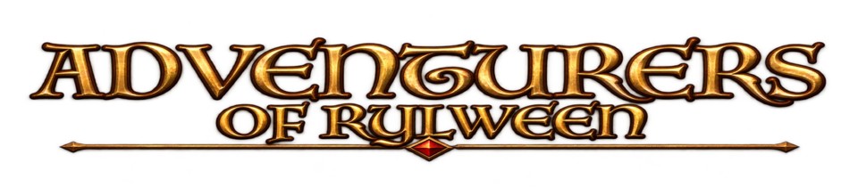
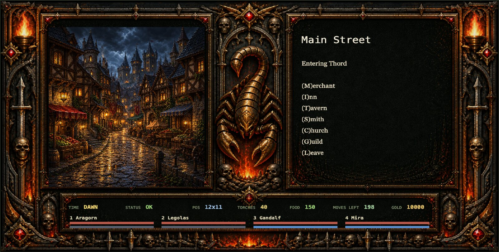
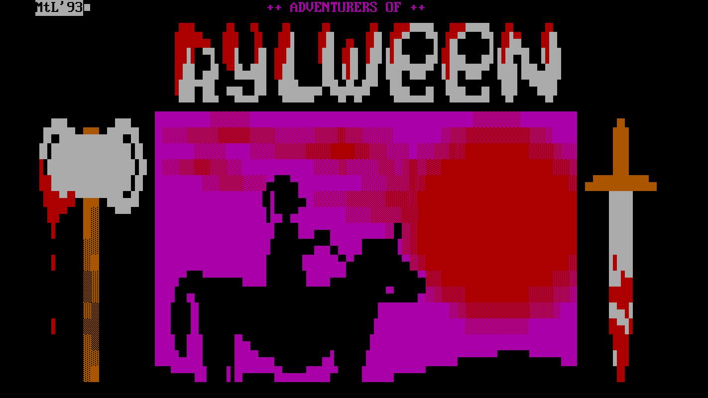
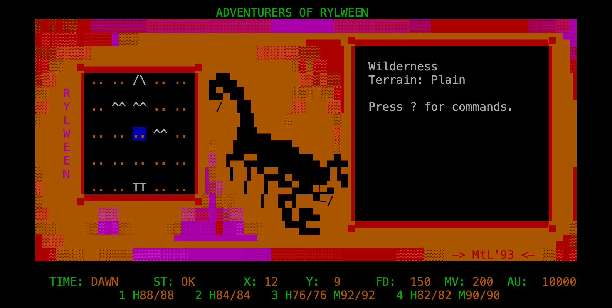
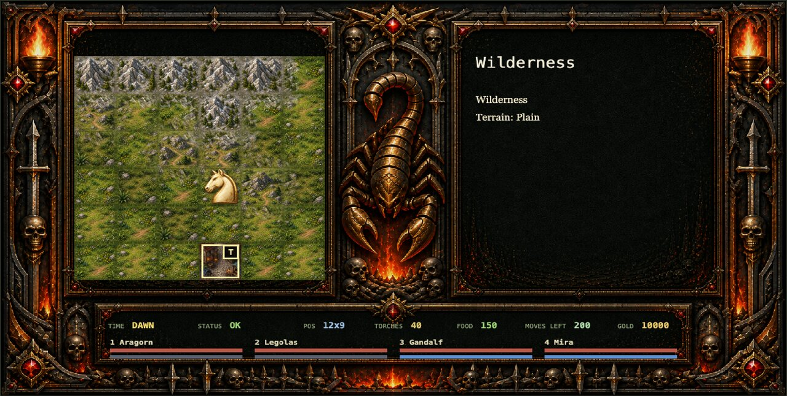
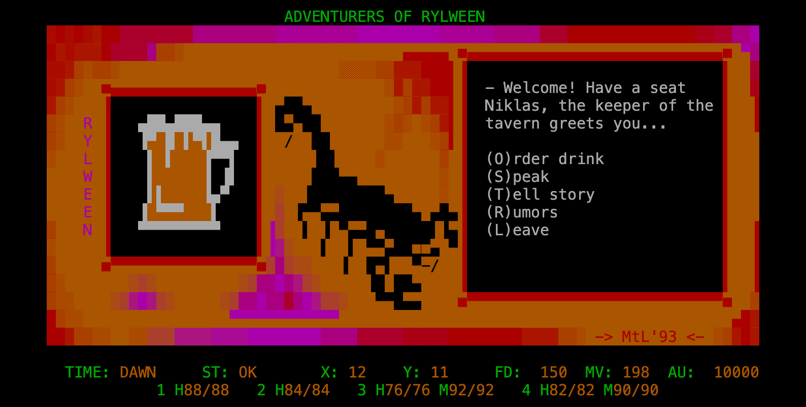
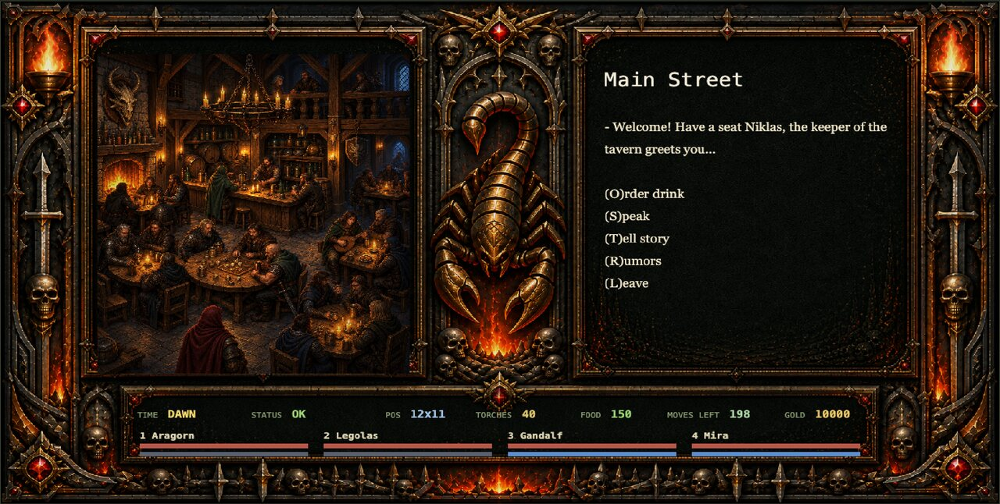
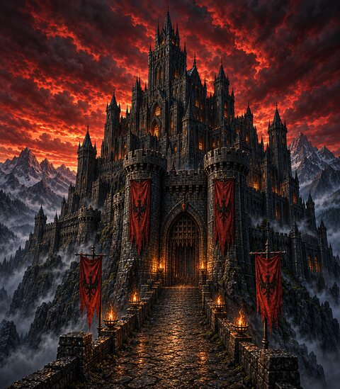
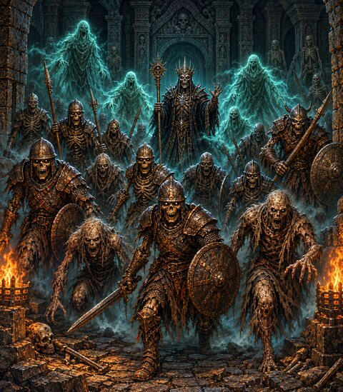

<h1 align="center">
  
</h1>

Kotlin port and runtime workspace for Adventurers of Rylween, a MUD
style game for BBSes that I wrote in 1992-1993. The same game plays in two
ways: as the original ANSI version in a terminal, and as a repainted bitmap
version in the browser.

[Play it](#running-the-game) in a browser or a terminal, host it for others
with [`deploy/README.md`](deploy/README.md), change the game with the
[DSL authoring guide](docs/dsl-authoring.md), or start on the code at
[The Code](#the-code).

<p align="center">
  
</p>

## Then And Now

Each pair below is the same moment in the same game: the title screen, a
party at dawn in the wilderness just north of Thord, and the tavern in Thord.
The ANSI version keeps the look of the 1993 original and plays in a terminal
with `./rylween`; the bitmap version is what `./rylween serve` serves to browsers.

<table>
  <tr>
    <th>ANSI, as on the BBS in 1993</th>
    <th>Bitmap, in the browser</th>
  </tr>
  <tr>
    <td></td>
    <td></td>
  </tr>
  <tr>
    <td></td>
    <td></td>
  </tr>
  <tr>
    <td></td>
    <td></td>
  </tr>
</table>

In the game DSL a picture is an image id bound to an ANSI tile, a bitmap
painting, or both, and each front end draws its own. A few of the paintings,
from [`game/src/main/resources/bitmap/assets`](game/src/main/resources/bitmap/assets):

<p align="center">
  
  
  
  
</p>

## Running The Game

### With Only Docker or Podman

Each release is published as an image, so a machine with Docker or Podman and
internet access needs nothing else: no checkout, no git, no JDK. One command
downloads the latest release and starts the bitmap game:

```sh
docker run --rm -it --pull always --name rylween -p 127.0.0.1:8081:8081 -v rylween-data:/data -e RYLWEEN_AUTH_SECURE_COOKIES=false ghcr.io/lagergren/rylween
```

With Podman, write `podman` for `docker`. Once the server is up it prints the
link to open, `http://localhost:8081/login`, where you register an account.
Ctrl-C stops it. Saves and accounts stay on the `rylween-data` volume, and the
next run picks up any newer release. The image expects HTTPS by default;
`RYLWEEN_AUTH_SECURE_COOKIES=false` lets logins work over plain HTTP on this
machine. On another port, say 9000, publish `-p 127.0.0.1:9000:8081` and add
`-e RYLWEEN_PUBLIC_URL=http://localhost:9000` so the printed link matches.

On a Mac, Homebrew installs either one. `brew install docker` alone installs
only the client, without the engine that runs the containers:

```sh
brew install podman && podman machine init --now   # Podman, and the Linux VM it runs containers in
brew install --cask docker                          # or Docker Desktop; start it once from Applications
```

### On This Machine Or Your Network: `./rylween serve`

```sh
./rylween serve          # this machine only, http://127.0.0.1:8081/
./rylween serve --lan    # every machine on the local network
```

From a checkout, this builds the bitmap game's image, starts it with Docker
Compose (Podman Compose when Docker is missing) on port 8081, and waits until it
answers. Then it prints the address to open, with the commands for the sysop
password, the server log, and stopping it. Saves and accounts survive rebuilds.
It serves only this machine (`--local`) unless `--lan` shares it on this
machine's LAN address; `./rylween stop` stops it.

### On The Internet, Over HTTPS

On a machine with a public address and a domain name, `./rylween serve --https`,
or `deploy/compose.https.yaml` on its own, runs the released game behind Caddy,
which gets a Let's Encrypt certificate for the name.

[`deploy/README.md`](deploy/README.md) covers all three ways: the `./rylween`
command and its defaults, the settings, data and backups, and the images, and,
step by step, everything an HTTPS server needs, from DNS and ports on.

### In A Terminal: `./rylween`

```sh
./rylween
```

This builds the game and plays the ANSI version in the current terminal. It
needs JDK 23 or newer; Gradle downloads the JDK 25 toolchain the modules build
with if none is installed. Without a checkout, download
`rylween-terminal-X.Y.Z.zip` from the
[latest release](https://github.com/lagergren/rylween/releases/latest), unzip
it, and run its `bin/rylween`, which takes the same options and needs Java 25
or newer. Size the terminal to at least 80 columns by 25 rows.
At the splash screen press RETURN, then `N` to create a party. Move with the
arrow keys or the keypad digits 8, 2, 4, and 6; press `?` in the wilderness for
the full list of commands, and `X` to quit. The save and logs go to
`~/.rylween/data`.

[`deploy/README.md`](deploy/README.md#playing-in-a-terminal) lists its options,
such as starting with a seeded Strong party, and `./rylween help` lists every
option of every command.

The game streams ANSI escape codes (color, cursor positioning) and uses
ambiguous-width Unicode characters in some art. How those characters are
sized depends on the terminal:

- **macOS `Terminal.app`** renders East-Asian-Width-ambiguous characters
  as 2 cells wide. Some art and layouts drift as a result. This isn't a
  bug in the game — `Terminal.app` makes the wrong call for the
  character set the game uses.
- Recommended terminals that get this right out of the box:
  **iTerm2**, **Ghostty**, **Alacritty**, **Kitty**, and **WezTerm**.
  Any of these renders the art as intended on macOS, Linux, and BSD.

If you must run in `Terminal.app`, expect occasional one-cell drift in
borders and decorative art. Gameplay text is unaffected.

## The Code

The version is set in one place, `rylween.version` in `gradle.properties`, and
shows on the title menu, in the bitmap page's title bar, in `/api/status`, and
in the `log.open` line of every runtime log. Between releases it is the snapshot
of the next patch release, `X.Y.Z-SNAPSHOT`; see [Releasing](#releasing).

The current runnable Kotlin game is the `:runtime` project. Shared
DSL/compiler and compiled-bundle contracts live under `:core`, authored game
DSL and resources live under `:game`, the compiled-bundle emitter and its checks
live under `:tools`, and ANSI terminal primitives live in `:runtime`.

The complete game DSL, the whole authored game from the world map and monsters
to every mission script, is
[`RylweenGame.kt`](game/src/main/kotlin/rylween/game/RylweenGame.kt); it pulls
in the sound and music from
[`RylweenAudio.kt`](game/src/main/kotlin/rylween/game/RylweenAudio.kt).
The original game text and manual live in
[`adventurers-of-rylween.md`](game/src/main/resources/adventurers-of-rylween.md).

Module guides:

- [DSL authoring guide](docs/dsl-authoring.md) - how to modify or extend the
  authored game.
- [`:core`](core/README.md) - DSL, validation, compiled bundle contracts.
- [`:game`](game/README.md) - authored Rylween game script, fixtures, assets.
- [`:runtime`](runtimes/runtime/README.md) - shared game runtime and direct ANSI terminal.
- [`:runtime-web`](runtimes/runtime-web/README.md) - browser-served ANSI runtime.
- [`:runtime-bitmap-web`](runtimes/runtime-bitmap-web/README.md) - canvas bitmap runtime.
- [`:web-common`](runtimes/web-common/README.md) - shared web HTTP, WebSocket, auth, status.
- [`:tools`](tools/README.md) - emits, checks, and inspects the compiled bundle.
- [`game/audio-tools`](game/audio-tools) - Python scripts that synthesize the sound effects, music, and ambient loops.
- [`build-logic`](build-logic/README.md) - Gradle conventions and custom tasks.
- [`deploy`](deploy/README.md) - running the game: the `rylween` command, compose files, Docker images, and HTTPS.

The old interpreted Kotlin ANSI project and the historical C/JSON5 port are no
longer part of this repository. The original Amiga release is kept as described
in the appendix.

## Verification

Run the normal verification graph:

```sh
./gradlew check --console=plain
```

`check` also runs `checkDependencyUpdates`, which only reports newer dependency
and plugin versions from `gradle/libs.versions.toml`. To apply those catalog
updates intentionally, run:

```sh
./gradlew updateDependencyCatalog --console=plain
```

CI (`.github/workflows/ci.yml`) runs the module checks on every push to `main`
and every pull request, leaving out the root dependency-update report:

```sh
./gradlew --console=plain :core:check :game:check :tools:check :web-common:check :runtime:check :runtime-web:check :runtime-bitmap-web:check
```

ktlint findings fail `check`; `./gradlew ktlintFormat --console=plain` fixes
most of them. Each scripted `:runtime:checkRuntime*` task writes its runtime log
and the launcher's screen output to
`runtimes/runtime/build/logs/runtime/<task>.log` and `<task>.out`. The runtime
tests keep their logs, saves, and autopilot reports in
`runtimes/runtime/build/test-logs/<TestClass>/<testMethod>/`. CI uploads both as
the `test-logs` artifact. The browser smoke check is not part of `check`; run it
with `./gradlew :runtime-bitmap-web:checkBitmapBrowserSmoke --console=plain`.

## Releasing

Releases come from `main`, through the release workflow
(`.github/workflows/release.yml`), which only ever starts by hand. To start it
from a checkout, with the GitHub CLI `gh` logged in:

```sh
./gradlew releaseDist --console=plain
./gradlew releaseDist -Prylween.release.dryRun=true --console=plain   # pushes and publishes nothing
```

With `main` at `X.Y.Z-SNAPSHOT`, the workflow runs the CI checks, commits
`X.Y.Z` and tags it `vX.Y.Z`, and builds and smoke-tests the two downloads: the
bitmap web game as the image `ghcr.io/lagergren/rylween:X.Y.Z` (also `:latest`)
for linux/amd64 and linux/arm64, and the terminal game as
`rylween-terminal-X.Y.Z.zip` (`./gradlew :runtime:terminalDistZip`), which runs
with `bin/rylween` on Java 25 or newer. It then moves `main` to
`X.Y.(Z+1)-SNAPSHOT` and publishes the GitHub release with the zip and a
`compose.yaml` that pulls the image. It refuses a version without `-SNAPSHOT`
and a version that is tagged already. For a minor or major release, first set
`rylween.version` to its snapshot, such as `X.(Y+1).0-SNAPSHOT`, in a pull
request.

`main` takes only pull requests, so the workflow pushes its commits with a
deploy key that the "Require PRs and CI on main" ruleset lets bypass that, kept
in the `RELEASE_DEPLOY_KEY` repository secret.

## Cleanup

Generated files are Gradle build output, local Kotlin compiler caches, the
direct launcher's default saves and logs under `build/`, and the bitmap web
client's `node_modules` and downloaded Node.js under `runtimes/runtime-bitmap-web/`.
`./rylween` keeps saves and logs in `~/.rylween/data`. From the repo root:

```sh
./gradlew clean --console=plain
```

This removes project build directories, the included `build-logic/build`
directory, and regenerated local `.kotlin` session/error caches. It leaves
`runtimes/runtime-bitmap-web/node_modules`, `runtimes/runtime-bitmap-web/.gradle`,
and `~/.rylween` in place.

## Questions

Ask questions and share ideas in
[GitHub Discussions](https://github.com/lagergren/rylween/discussions).

## Appendix: the original Amiga release

The original Amiga release of the game is kept as
[`docs/original/rylween-amiga.zip`](docs/original/rylween-amiga.zip). It holds the
`Rylween` executable, the manual (`Rylween.DOC`), the sysop notes
(`Sysop.TXT` and `IMPORTANT!.README`), the data files, and the ANSI title and
status screens, dated 1993 to 1996. It needs AmigaOS, on a real or emulated
Amiga, and runs as a door program on a BBS.

The game asks for a registration file. Generate one with
[rylween-regfile-generator](https://github.com/lagergren/rylween-regfile-generator),
the repository this archive was copied from.
